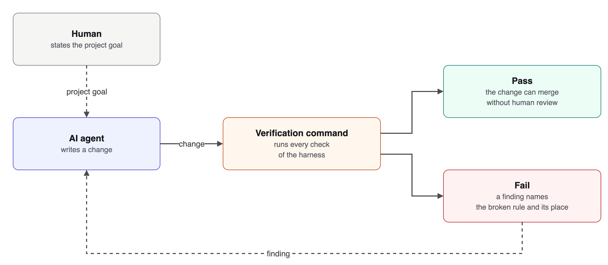
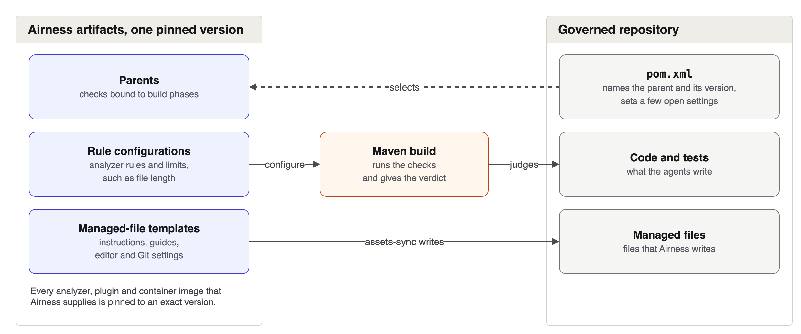
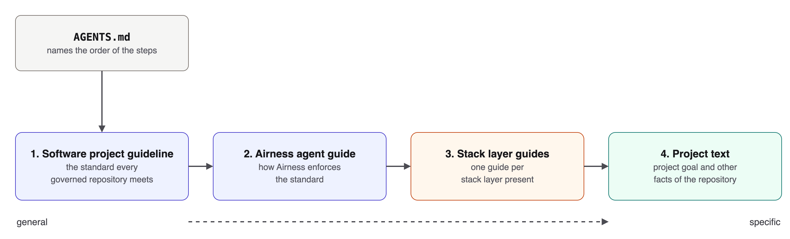

[.text-justify]
= Airness
:reproducible:
:doctype: article
:author: Herman Ciechanowiec
:email: herman@ciechanowiec.eu
:chapter-signifier:
:sectnums:
:sectnumlevels: 5
:sectanchors:
:toc: left
:toclevels: 5
:icons: font
:linkcss:
:sourcedir: {docdir}
:stylesdir: https://www.ciechanowiec.eu/linux_mantra/
:stylesheet: adoc-css-style.css
:!table-caption:
:!figure-caption:
:!example-caption:

ifdef::backend-html5[]
ifndef::env-github[]
++++
<link href="https://www.ciechanowiec.eu/linux_mantra/adoc-docinfo.css" rel="stylesheet">

++++
endif::[]
endif::[]

:airness-version: 1.0.14-SNAPSHOT

[cols=">.^1h,<.^1"]
// The two-row metadata table labels its rows in its first column, not its columns.
// adocent-disable-next-line Structure.TableHeaders
|===
| Document last modified: | {docdatetime}
| Document generated: | {localdatetime}
|===

Airness is a build xref:#harness[harness] for software repositories that https://maven.apache.org[Maven^] builds and whose code AI agents write. Each xref:#module[module] of the build inherits an xref:#airness-parent[Airness parent], and from then on the build runs the automated xref:#check[checks] that the software project guideline requires for the repository's technology stack. The build fails when any check fails, so a change that passes can merge without human code review. This document explains the mechanisms behind that outcome: checks and xref:#finding[findings], Airness parents, xref:#node-project[node projects], xref:#managed-file[managed files], rules a repository can't turn off, agent instructions, build commands, the build lifecycle, and the areas the rules cover. It then shows how a new application starts with Airness. The agent guides, which agents read, hold the exact rules, so this document names only the main ones.

[[code-without-human-review]]
== Code Without Human Review

. A [[governed-repository]]_governed repository_ is a software repository in which AI agents write all the code and changes merge without human review. The link:README-guideline-software-project.adoc[software project guideline^] defines it and states the rules that such a repository keeps. Every repository that uses Airness carries a copy of that guideline.
. No human reviews the code of a xref:#governed-repository[governed repository], so a machine must check every rule that it can verify reliably. A [[check]]_check_ is an automated verification with exactly two verdicts: _pass_ and _fail_. A check that can't run fails as well. No warning exists between the two verdicts. A [[harness]]_harness_ is the complete set of checks of a repository.
. A [[verification-command]]_verification command_ runs every xref:#check[check] of the xref:#harness[harness] and gives one verdict for all of them. A [[finding]]_finding_ is the report of a failed check: it names the broken rule and the place that breaks it.
. Airness is a xref:#harness[harness] for repositories that https://maven.apache.org[Maven^] builds. It turns the rules of the software project guideline that a machine can verify into xref:#check[checks] for the technologies Airness supports: https://dev.java[Java^], https://spring.io/projects/spring-boot[Spring Boot^], https://tc39.es/ecma262/[JavaScript^] and https://www.typescriptlang.org[TypeScript^], and https://payloadcms.com[Payload CMS^]. A rule that no check can verify reliably reaches agents as an instruction, as the section xref:#agent-instructions[] describes.
. The [[project-goal]]_project goal_ is the statement in `AGENTS.md` of what the software of a xref:#governed-repository[governed repository] achieves and for whom. Only a human changes the project goal.
. Work in a xref:#governed-repository[governed repository] runs in a loop:
+
[[change-loop-figure]]
.Path of a change from an AI agent to a merge

+
An AI agent writes a change that serves the xref:#project-goal[project goal], and the xref:#verification-command[verification command] runs on it. The agent repairs each xref:#finding[finding], and the command runs again. The change reaches the main branch only after a pass.

[[checks-and-findings]]
== Checks and Findings

. A https://maven.apache.org[Maven^] build that inherits Airness ends with `BUILD SUCCESS` when every xref:#check[check] passed. When a check fails, the log carries the check's xref:#finding[finding], and the build ends with `BUILD FAILURE`. For example, a `CLAUDE.md` file anywhere in a xref:#governed-repository[governed repository] breaks xref:#forbidden-instruction-files[a rule on agent instructions], and the build fails with this finding:
+
[source,text]
----
CLAUDE.md files are forbidden because Claude Code reads AGENTS.md (delete them) (1):
  docs/CLAUDE.md
----
+
The first line of the xref:#finding[finding] states the rule and the repair, the number in parentheses counts the offending places, and each indented line names one place.
. Airness writes each xref:#finding[finding] for the agent that repairs it. The agent repairs the code that causes the finding. Turning the xref:#check[check] off isn't a repair, as the section xref:#harness-integrity[] explains.
. [[report-only-mode]]_Report-only mode_ is a run in which the build lists the xref:#finding[findings] of every xref:#check[check] without failing on them. The flag `-Dairness.enforce=false` selects it. Compilation errors and tool failures still fail the build. A run in report-only mode is never a pass, so it only measures the work that an adoption of Airness needs.
. [[skip-tests]]The flag `-DskipTests` skips the tests and nearly every Airness xref:#check[check]. Such a build produces the artifacts and no verdict.

[[airness-parents]]
== Airness Parents

. A [[module]]_module_ is a part of a https://maven.apache.org[Maven^] build that describes its build in a `pom.xml` file of its own. A build consists of one or more modules. The file can name a parent, a published build configuration that the module inherits: its plugins, the build phases they run in, and their settings. An [[airness-parent]]_Airness parent_ is one of the five parents that Airness publishes, each for a different kind of module. A module that names one inherits every xref:#check[check] of that parent.
+
For example, the https://maven.apache.org[Maven^] build of an online shop can consist of three xref:#module[modules], and each of them names the xref:#airness-parent[Airness parent] that matches its content:
+
[[module-parents-figure]]
.Modules of a Maven build and the Airness parents they name
image::.adocent/resources/visuals/module-parents.drawio.png["A Maven build with three modules, drawn as a directory tree. The root module shop holds a pom.xml file and no code of its own and names airness-parent, the parent for a repository root or a module without code. The module order-service, a directory inside shop, holds a pom.xml file and Java code and names airness-parent-java, the parent for a Java module. The module web, another directory inside shop, holds a pom.xml file and TypeScript code and names airness-parent-node, the parent for a JavaScript or TypeScript module. Each module inherits from its parent the plugins, the build phases they run in, their settings, and the checks."]
+
Each dashed arrow points from a xref:#module[module] to the parent that its `pom.xml` file names.
. For example, the following complete `pom.xml` file makes a https://dev.java[Java^] xref:#module[module] with classes under `com.example.orders` inherit the Java parent:
+
[source,xml,subs="attributes+"]
----
<?xml version="1.0" encoding="UTF-8"?>
<project xmlns="http://maven.apache.org/POM/4.0.0"
         xmlns:xsi="http://www.w3.org/2001/XMLSchema-instance"
         xsi:schemaLocation="http://maven.apache.org/POM/4.0.0
                             https://maven.apache.org/xsd/maven-4.0.0.xsd">
    <modelVersion>4.0.0</modelVersion>

    <parent>
        <groupId>eu.ciechanowiec</groupId>
        <artifactId>airness-parent-java</artifactId>
        <version>{airness-version}</version>
        <relativePath/>
    </parent>

    <groupId>com.example</groupId>
    <artifactId>order-service</artifactId>
    <version>1.0.0-SNAPSHOT</version>

    <properties>
        <airness.package.root>com.example.orders</airness.package.root>
    </properties>
</project>
----
+
[[package-root]]`airness.package.root` is the common prefix of every production and test package. For example, the packages `com.example.orders.api` and `com.example.orders.storage` share the root `com.example.orders`. This setting is the only one that a module must declare.
. The xref:#airness-parent[Airness parents] form a hierarchy with `airness-parent` at its top. Every other parent inherits the parent above it and adds what its kind of xref:#module[module] needs:
+
[[parent-chain-figure]]
.Airness parents and what each one adds
image::.adocent/resources/visuals/parent-chain.drawio.png["airness-parent holds the repository rules: instructions, commit history, secrets, dependencies, and JavaScript and TypeScript. airness-parent-java inherits it and adds the Java rules: compiler, static analysis, tests, and coverage. airness-parent-spring-boot inherits airness-parent-java and adds the Spring Boot platform and rules and the evidence that the application started. airness-parent-node also inherits airness-parent and serves a module whose content is JavaScript or TypeScript. airness-parent-payload inherits airness-parent-node and adds the Payload CMS rules."]
+
Each arrow points from a parent to the parent that inherits it.
. A xref:#module[module] names the xref:#airness-parent[Airness parent] that matches its content:
+
[cols="2,3",options="header"]
|===
| Parent | Module content
| `airness-parent` | a repository root or a xref:#module[module] with no code of its own
| `airness-parent-java` | https://dev.java[Java^] code
| `airness-parent-spring-boot` | a https://spring.io/projects/spring-boot[Spring Boot^] application
| `airness-parent-node` | mainly https://tc39.es/ecma262/[JavaScript^] or https://www.typescriptlang.org[TypeScript^], such as a single-page application
| `airness-parent-payload` | a https://payloadcms.com[Payload CMS^] application
|===
+
Each xref:#airness-parent[Airness parent] serves one kind of xref:#module[module], so the parent that a module names decides which rules apply. A module with https://dev.java[Java^] code that inherits `airness-parent` fails, and the xref:#finding[finding] tells it to inherit `airness-parent-java`.
. A new technology joins Airness with an xref:#airness-parent[Airness parent] of its own and leaves the rules of the other technologies unchanged. https://payloadcms.com[Payload CMS^] joined Airness this way, through `airness-parent-payload`.

[[node-projects]]
== Node Projects

. A [[node-project]]_node project_ is a directory of https://tc39.es/ecma262/[JavaScript^] or https://www.typescriptlang.org[TypeScript^] code with a `package.json` file, which Airness checks. A xref:#module[module] declares its node projects in the setting `airness.node.projects`, and the directory of a module that inherits `airness-parent-node` is a node project itself. For example, a https://dev.java[Java^] module with a frontend keeps its Java parent and declares the frontend's directory:
+
[source,xml]
----
<!-- the rest of pom.xml is omitted -->
<properties>
    <airness.package.root>com.example.orders</airness.package.root>
    <airness.node.projects>src/main/frontend</airness.node.projects>
</properties>
----
. Airness installs the versions of https://nodejs.org[Node.js^] and https://pnpm.io[pnpm^] that it pins, checks each download against a pinned digest, and keeps them in the local https://maven.apache.org[Maven^] repository, so neither needs an installation by hand. The dependencies of a xref:#node-project[node project] install from its lockfile, with every install script switched off except those that the node project approves.
. Every xref:#node-project[node project] declares the https://www.npmjs.com[npm^] package `@airness/node` as a development dependency. The package holds the xref:#check[checks] for https://tc39.es/ecma262/[JavaScript^] and https://www.typescriptlang.org[TypeScript^], together with the analyzers they run and the configurations they read. A [[gate]]_gate_ is one of these checks, run as one execution of the https://maven.apache.org[Maven^] build, so a node project gets its verdict from the same command as https://dev.java[Java^] code. The gates cover types, lint, architecture, dead code, tests with 80% coverage, and install scripts, among others.
. Every hand-written script and style sheet that a commit carries must lie in a declared xref:#node-project[node project]. Such a file outside every node project fails the build, so no frontend code escapes the xref:#check[checks].

[[managed-files]]
== Managed Files

. Several tools read their configuration from files in the working tree, such as https://git-scm.com[Git^] from `.gitignore` and AI agents from `AGENTS.md`. A [[managed-file]]_managed file_ is such a file whose content Airness decides, so that xref:#governed-repository[governed repositories] share one setup.
. A [[stack-layer]]_stack layer_ is the group of xref:#managed-file[managed files] and rules for one kind of repository content: `generic` for every repository, `java` for a https://dev.java[Java^] xref:#module[module], `node` for a xref:#node-project[node project], and `payload` for a https://payloadcms.com[Payload CMS^] module.
. Each xref:#managed-file[managed file] follows a policy, and the main policies are:
+
[cols="1,3,2",options="header"]
|===
| Policy | Rule | Example
| Pinned | The file matches the Airness version byte for byte. | `.editorconfig`
| Managed section | The file starts with blocks that Airness writes, and the text below them belongs to the xref:#governed-repository[governed repository]. | `AGENTS.md`
| Seed | Airness creates the file when it's missing, and the content belongs to the xref:#governed-repository[governed repository]. | `.gitleaks.toml`
| Scaffold | Airness creates the file once, on request, and the file belongs to the xref:#governed-repository[governed repository] afterward. | a verification workflow
| Forbidden | The file must not exist. | `rewrite.yml`
|===
. The `assets-sync` goal writes the missing and outdated xref:#managed-file[managed files]:
+
[source,bash]
----
mvn airness:assets-sync
----
+
The build fails on an outdated pinned file or managed section, so a new Airness version can ask for one run of the goal.

[[harness-integrity]]
== Harness Integrity

. A rule that a xref:#governed-repository[governed repository] could turn off would protect nothing, because the agent that breaks the rule could also turn it off. Airness therefore keeps the configuration of every xref:#check[check] in its own artifacts, beyond the repository's reach, apart from a few open settings:
+
[[rule-ownership-figure]]
.Division between the Airness artifacts and a governed repository

+
Every analyzer, plugin, and container image that Airness supplies is pinned to an exact version, so a new release of a tool can't change a verdict.
. A xref:#governed-repository[governed repository] sets only the few settings that the xref:#harness[harness] leaves open, such as xref:#package-root[`airness.package.root`]. The build fails on any other setting that would change a xref:#check[check].
. A [[suppression]]_suppression_ is a marker in the code that turns one rule off at one place and states the reason. For example, a https://dev.java[Java^] method that has to catch a generic exception carries two annotations:
+
[source,java]
----
// imports and the enclosing class omitted
@Justification("the vendor client declares Exception on every call, and the import reports each failed row")
@SuppressWarnings("PMD.AvoidCatchingGenericException")
void importRow(VendorClient client, String row) {
    // method body omitted
}
----
+
The number of xref:#suppression[suppressions] has a ceiling that grows with the size of the code, and no setting raises it.
. A xref:#governed-repository[governed repository] can't turn a xref:#check[check] off, except through xref:#suppression[suppressions] and through known vulnerabilities that it records as not exploitable. A check that is wrong for the repository is a defect of Airness, and its maintainers fix it in Airness.

[[agent-instructions]]
== Agent Instructions

. An [[instruction-file]]_instruction file_ is a committed file that states the rules of a xref:#governed-repository[governed repository] for AI agents. Every agent starts at `AGENTS.md` in the repository root. [[forbidden-instruction-files]]The build fails on other instruction files, such as `CLAUDE.md`, because they could contradict `AGENTS.md`.
. `AGENTS.md` sends an agent through four documents, from the general to the specific:
+
[[instruction-chain-figure]]
.Order in which an agent reads its instructions

+
A later document may strengthen an earlier one but never weaken it.
. The first three documents are xref:#managed-file[managed files], so Airness, not the xref:#governed-repository[governed repository], decides their content.
. The instructions carry the rules that no xref:#check[check] verifies reliably, such as the rule that a test must fail when the code stops doing what the test's name says.

[[build-commands]]
== Build Commands

. Running every xref:#check[check] takes time, so Airness offers several levels of verification. [[default-verification]]_Default verification_ is the level for everyday work, which runs a subset of the checks that finishes faster. [[extended-verification]]_Extended verification_ is the level that runs every check, so it's the xref:#verification-command[verification command].
. The [[compliance-report]]_compliance report_ is an https://html.spec.whatwg.org[HTML^] and https://www.iso.org/standard/75839.html[PDF^] document that xref:#extended-verification[Extended verification] writes. It lists every dependency of the build in a software bill of materials (SBOM). For each dependency, it says whether the product ships it, and it reprints the license files of every dependency the product ships.
. The [[browser-sweep]]_browser sweep_ is the xref:#check[check] of xref:#extended-verification[Extended verification] that starts the application, discovers its pages, and visits them in https://www.chromium.org[Chromium^], https://www.firefox.com[Firefox^], and https://webkit.org[WebKit^]. It judges layout, text, keyboard behavior, network requests, and accessibility.
. xref:#extended-verification[Extended verification] runs every xref:#check[check] of xref:#default-verification[Default verification] and adds, among others:
.. the known-vulnerability scan of the dependencies and container images,
.. the xref:#check[checks] of the whole commit history, of secrets, and of https://www.jetbrains.com/qodana/[Qodana^], a code-quality analyzer,
.. the scanners of shell scripts, https://docs.docker.com/reference/dockerfile/[Dockerfiles^], and workflows,
.. the xref:#compliance-report[compliance report],
.. the xref:#browser-sweep[browser sweep],
.. the build and start of container images.
. A third level, [[delta-verification]]_Delta verification_, is xref:#extended-verification[Extended verification] with the xref:#browser-sweep[browser sweep] narrowed to the pages that a change reaches, in https://www.chromium.org[Chromium^] only. Its verdict covers the change, not the whole application.
. The option `-P` activates a [[maven-profile]]_Maven profile_, a named set of build settings. Each level of verification is one https://maven.apache.org[Maven^] command:
+
[cols="1,2",options="header"]
|===
| Level | Command
| xref:#default-verification[Default verification] | `mvn clean verify`
| xref:#extended-verification[Extended verification] | `mvn clean verify -Pextended`
| xref:#delta-verification[Delta verification] | `mvn clean verify -Pextended,delta`
|===
. The following figure compares the three levels of verification:
+
[[verification-levels-figure]]
.Checks of Default, Extended, and Delta verification
image::.adocent/resources/visuals/verification-levels.drawio.png["Default verification, run by mvn clean verify, covers the Maven model and managed files, formatting and static analysis, tests and coverage, node gates, and dependency licenses and freshness. Extended verification, run by mvn clean verify -Pextended, contains all of Default verification and adds the known-vulnerability scan, the commit history, secrets, and Qodana checks, the compliance report with a software bill of materials, the browser sweep in three engines, and the container image build and boot. Delta verification, run with -Pextended,delta, is Extended verification with the browser sweep narrowed to what the change reaches, in Chromium only."]
. [[verification-needs]]Every level of verification needs network access. xref:#extended-verification[Extended verification] also needs https://www.docker.com[Docker^] and the whole commit history, and xref:#default-verification[Default verification] needs Docker where tests start services, such as a database.
. Run xref:#extended-verification[Extended verification] before a change is finished. When a continuous integration (CI) job runs Extended or xref:#delta-verification[Delta verification] on every pull request, xref:#default-verification[Default verification] is enough locally.

[[build-lifecycle]]
== Build Lifecycle

. https://maven.apache.org[Maven^] runs a build as a fixed sequence of phases, from `validate` to `verify`, and binds each plugin execution to one phase. The xref:#airness-parent[Airness parents] bind each xref:#check[check] to a phase in which its input exists:
+
[[build-lifecycle-figure]]
.Phases of a Maven build and the checks that run in them
image::.adocent/resources/visuals/build-lifecycle.drawio.png["Eight boxes run in two rows. validate checks the Maven model, the managed files, the node projects, and the run order. initialize installs the pinned Node.js and pnpm and the locked dependencies. The third box stands for the phases from compile to test, which check formatting and compiler rules and run Checkstyle and the unit tests. prepare-package runs the node gates and PMD. package runs SpotBugs and checks licenses and freshness, and in Extended verification also known vulnerabilities and secrets. integration-test runs the integration tests. post-integration-test runs the browser sweep and the image boot of Extended verification and checks the evidence that the application started. verify checks coverage and runs the closing step, which also compares the tree with its state at the start of the build."]
+
A defect that a fast xref:#check[check] finds in an early phase fails the build before the slow checks of the later phases start.
. The [[closing-step]]_closing step_ is the last execution of the build, which judges the build as a whole once the last xref:#module[module] completes. Among other things, the closing step:
.. fails when the build changed a tracked file,
.. holds the xref:#suppression[suppressions] to their ceiling,
.. fails every xref:#module[module] that holds code without inheriting an xref:#airness-parent[Airness parent].

[[governed-areas]]
== Governed Areas

The rules of Airness cover the whole state of a repository, not only its code. xref:#check[Checks] verify most of them, and the rest reach agents as xref:#agent-instructions[instructions]. The following table gives a sample of the rules in each area:

[cols="1,4",options="header"]
|===
| Area | Examples of rules
| Code | Files of at most 500 lines, methods of at most 50 lines, no https://projectlombok.org[Lombok^] builders, and static analysis.
| Tests | Real databases instead of test doubles, 80% line and branch coverage, a shuffled test order, and no network beyond the machine.
| Security | No secret in the files or the commit history, security headers, and rules for authorization and authentication.
| Dependencies | Allowed licenses, no known vulnerability, and no dependency two major versions behind its latest release.
| Version control | The form of commit messages and a linear history.
| Repository | xref:#managed-file[Managed files], ignore files, and workflows.
| Browser | Accessibility, layout, and keyboard behavior of every page.
| Containers | Images that build without secrets and run as an unprivileged user.
|===

[[getting-started]]
== Getting Started

. Airness needs exactly https://dev.java[Java^] `25`, https://maven.apache.org[Maven^] `3.10.0` or later, and a https://git-scm.com[Git^] working tree. xref:#verification-needs[Some levels of verification also need Docker].
. A [[starter-application]]_starter application_ is a working application that already passes xref:#extended-verification[Extended verification] and is the starting point of a new application. Airness ships two starter applications:
.. `spring-boot`, a multi-user task tracker built with https://spring.io/projects/spring-boot[Spring Boot^], https://www.thymeleaf.org[Thymeleaf^], https://htmx.org[htmx^], https://tailwindcss.com[Tailwind CSS^], and https://www.postgresql.org[PostgreSQL^],
.. `payload-cms`, a content site built with https://payloadcms.com[Payload CMS^], https://nextjs.org[Next.js^], https://www.postgresql.org[PostgreSQL^], and https://aws.amazon.com/s3/[S3^]-compatible storage.
. The `new` goal makes an application from a xref:#starter-application[starter application] in a new directory and commits it as the first commit of a new https://git-scm.com[Git^] repository.
. For example, this command makes a https://spring.io/projects/spring-boot[Spring Boot^] application in the directory `task-tracker`:
+
[source,bash,subs="attributes+"]
----
mvn eu.ciechanowiec:airness-maven-plugin:{airness-version}:new \
    -Dairness.groupId=com.example -Dairness.artifactId=task-tracker
----
. For example, this command makes a https://payloadcms.com[Payload CMS^] application in the directory `content-site`:
+
[source,bash,subs="attributes+"]
----
mvn eu.ciechanowiec:airness-maven-plugin:{airness-version}:new \
    -Dairness.groupId=com.example -Dairness.artifactId=content-site \
    -Dairness.starter=payload-cms
----
. Run `mvn clean verify` in the new directory for the first verdict. The application's `AGENTS.md` names the commands that start it locally.

== About the Document

. The source text of this document is written in the https://asciidoc.org[AsciiDoc^] markup language.
. The source text of this document must follow the link:README-guideline-writing.adoc[Writing Guideline for Utilitarian Non-Fiction^]. The guideline is stored beside the source text in the same Git repository.
. The https://github.com/ciechanowiec/adocent[`adocent`^] application lints, converts, and watches the source text of this document.
. *Usage of https://github.com/ciechanowiec/adocent[`adocent`^]*
+
`adocent usage` prints the complete https://github.com/ciechanowiec/adocent[`adocent`^] manual and JSON reference catalogs, producing a large output. Don't run it during routine writing. Use it only when command help and lint diagnostics don't resolve a specific usage problem. Save the output to a temporary file and read only the relevant sections. AI agents must not load the full output into their context.
. *Linting*
+
To lint the source text of this document, run this command from the directory containing the source text:
+
[source,bash,subs="attributes+"]
----
adocent lint "{docname}{docfilesuffix}"
----
. *Converting*
+
To convert this document to HTML, PDF, and DOCX, run this command from the directory containing the source text:
+
[source,bash,subs="attributes+"]
----
adocent convert "{docname}{docfilesuffix}" --to html --to pdf --to docx
----
. *Watching*
+
To open a live HTML preview of this document, run this command from the directory containing the source text:
+
[source,bash,subs="attributes+"]
----
adocent watch "{docname}{docfilesuffix}"
----

ifdef::backend-html5[]
ifndef::env-github[]
++++

++++
endif::[]
endif::[]
