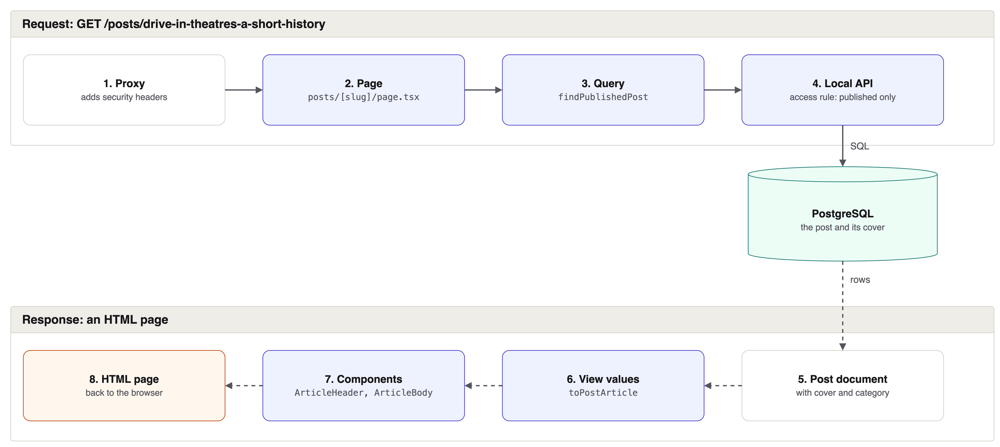
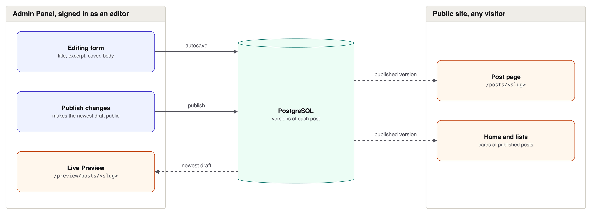

[.text-justify]
= Starter
:reproducible:
:doctype: article
:author: Herman Ciechanowiec
:email: herman@ciechanowiec.eu
:chapter-signifier:
:sectnums:
:sectnumlevels: 5
:sectanchors:
:toc: left
:toclevels: 5
:icons: font
:linkcss:
:sourcedir: {docdir}
:stylesdir: https://www.ciechanowiec.eu/linux_mantra/
:stylesheet: adoc-css-style.css
:!table-caption:
:!figure-caption:
:!example-caption:

ifdef::backend-html5[]
ifndef::env-github[]
++++
<link href="https://www.ciechanowiec.eu/linux_mantra/adoc-docinfo.css" rel="stylesheet">

++++
endif::[]
endif::[]

:l-payload: https://payloadcms.com/[Payload^]
:l-nextjs: https://nextjs.org/[Next.js^]
:l-react: https://react.dev/[React^]
:l-typescript: https://www.typescriptlang.org/[TypeScript^]
:l-tailwind-css: https://tailwindcss.com/[Tailwind CSS^]
:l-daisyui: https://daisyui.com/[daisyUI^]
:l-lucide: https://lucide.dev/[Lucide^]
:l-fontsource: https://fontsource.org/[Fontsource^]
:l-storybook: https://storybook.js.org/[Storybook^]
:l-postgresql: https://www.postgresql.org/[PostgreSQL^]
:l-rustfs: https://rustfs.com/[RustFS^]
:l-docker: https://www.docker.com/[Docker^]
:l-maven: https://maven.apache.org/[Maven^]
:l-nodejs: https://nodejs.org/[Node.js^]
:l-pnpm: https://pnpm.io/[pnpm^]
:l-vitest: https://vitest.dev/[Vitest^]
:l-playwright: https://playwright.dev/[Playwright^]
:l-airness: https://github.com/ciechanowiec/airness[Airness^]
:l-chromium: https://www.chromium.org/[Chromium^]
:l-firefox: https://www.firefox.com/[Firefox^]
:l-webkit: https://webkit.org/[WebKit^]
:l-git: https://git-scm.com/[Git^]

[[abstract]]
== Abstract

This repository holds Starter, a small film journal that serves as a starting point for new content sites. xref:#editor[Editors] write posts in the {l-payload} Admin Panel, preview each xref:#draft[draft] beside the editing form, and publish it. Visitors read the published posts on a public site that {l-nextjs} renders on the server. The content lives in {l-postgresql}, and the uploaded images live in an S3-compatible object store. The {l-airness} xref:#build-harness[build harness] turns every rule that automation can verify into a check of the build, so changes that AI agents write can merge without a developer reading every line. One {l-maven} build verifies the repository and builds the production server, and xref:#extended-verification[extended verification] also packages the server as a container image. A xref:#generated-project[generated project] starts as a copy of this working film journal, and its developers change the copy into their own site.

[[purpose-and-technologies]]
== Purpose and Technologies

. Starter is a web application in which editors keep posts, categories, and images, and visitors read the published posts by category or in a list of every post. An [[editor]]_editor_ is a user with the role `editor` or `admin`. A user with the role `admin`, an [[administrator]]_administrator_, also manages the accounts.
. The application combines, among others, the technologies in the following table.
+
[cols="2,3",options="header"]
|===
|Technology |Role in the application
|{l-payload} |content management: the content, the accounts, and the Admin Panel
|{l-nextjs} and {l-react} |server rendering of the pages
|{l-typescript} |language of the code, the tests, and the scripts
|{l-tailwind-css} and {l-daisyui} |styling
|{l-lucide} and {l-fontsource} |icons and self-hosted fonts
|{l-storybook} |workshop for the xref:#component[components]
|{l-postgresql} |database
|{l-rustfs} |object store for the uploaded images
|{l-vitest} and {l-playwright} |tests
|{l-maven}, {l-nodejs}, {l-pnpm}, and {l-airness} |build and verification
|{l-docker} |services for the tests and the container image
|===

[[project-template]]
== Project Template

. A [[project-template-definition]]_project template_ is a repository that new projects start from as copies. Starter is a project template. A [[generated-project]]_generated project_ is a copy of the template under its own Maven group, artifact, and package names. The goal `airness:new` of the {l-airness} Maven plugin writes a generated project, starts a {l-git} repository in it, and commits the result as its first commit.
. A xref:#generated-project[generated project] passes every check of the build from the start, so a developer makes the first change on a project that already passes.
. The film journal is an example, not a requirement. A xref:#generated-project[generated project] starts as a working film journal, and its developers turn it into their own site with ordinary changes. For example, they rename the site, restyle the theme, replace the demo posts, and add their own xref:#collection[collections] and pages.

[[airness-governance]]
== Airness Governance

{l-airness} is a [[build-harness]]_build harness_: {l-maven} parents, plugin goals, and {l-typescript} checks that a project inherits, so that changes that AI agents write can merge without a developer reading every line.

[[verification-levels]]
=== Verification Levels

{l-airness} checks a project at two verification levels. A change is ready to merge only when both levels pass.

. The command `mvn clean verify` runs [[default-verification]]_default verification_, which checks, tests, and builds the application. Developers run default verification while they work.
. The command `mvn clean verify -Pextended` runs [[extended-verification]]_extended verification_, which adds the slower checks to xref:#default-verification[default verification]. Among others, extended verification scans for known vulnerabilities and secrets, checks the {l-git} history, and builds the container image and starts it against empty services.
. xref:#extended-verification[Extended verification] also runs the [[browser-checks]]_browser checks_: the end-to-end tests and the browser sweep. The [[browser-sweep]]_browser sweep_ opens every page reachable through the links of the site and every xref:#component[component] state that {l-storybook} shows in {l-chromium}, {l-firefox}, and {l-webkit}. Among others, the browser sweep checks the pages for accessibility, display at different screen widths, keyboard use, and the security headers of the response.
. At the end, xref:#extended-verification[extended verification] writes a [[compliance-report]]_compliance report_, a document that lists, among others, the dependencies, their licenses, and their known vulnerabilities.

[[rules-and-checks]]
=== Rules and Checks

. {l-airness} turns every rule of the software project guideline, `README-guideline-software-project.adoc`, that automation can verify into a check of the build. Among others, the checks cover the tool versions, the formatting and the static analysis of the code, and the tests and their coverage. Other checks cover the licenses and known vulnerabilities of the dependencies and of the container image, the pages and the xref:#component[components] in real browsers, and the {l-git} history. A change that breaks a checked rule fails the build in the same way as a failing test.
. Starter receives the checks by inheritance. Its file `pom.xml` names the {l-airness} parent for {l-payload} applications, so the build runs every check of that parent:
+
.`pom.xml`, shortened
[source,xml]
----
<parent>
    <groupId>eu.ciechanowiec</groupId>
    <artifactId>airness-parent-payload</artifactId>
    <version>@AIRNESS_VERSION@</version>
    <relativePath/>
</parent>
----
. The {l-airness} parent for {l-payload} applications adds checks of the {l-payload} configuration. For example, the build fails when the configuration doesn't state, for each kind of content, who may create, read, change, and delete it. The build also fails when a xref:#draft[draft] could reach a visitor, or when a change of the database schema has no migration file to apply it.
. *Declared exceptions*
+
A project can't switch a check off. A project declares each deliberate exception in `package.json`, together with its reason, and the check then accepts that exception only. For example, the block `airnessPayload.publicAccess` lists what a visitor who isn't signed in can read, field by field. xref:#extended-verification[Extended verification] asks the running application what such a visitor can do and fails on every permission that the block doesn't declare:
+
.`package.json`, shortened
[source,json]
----
{
  "airnessPayload": {
    "publicAccess": [
      {
        "entity": "categories",
        "operation": "read",
        "reason": "the categories are the public site's topics, which its navigation and category pages show to every visitor",
        "fields": ["title", "slug", "description", "updatedAt", "createdAt"]
      }
    ]
  }
}
----
. `AGENTS.md` and the guides under `.airness/` state the rules that automation can't verify and the commands that AI agents run.
. A [[managed-file]]_managed file_ is a file, or a marked block inside a file, that {l-airness} writes into the repository and keeps identical to the copy that {l-airness} ships, such as the guides under `.airness/` and the blocks at the top of `AGENTS.md`. xref:#default-verification[Default verification] fails when a managed file differs from the {l-airness} copy. The command `mvn airness:assets-sync` restores the managed file.

[[application-architecture]]
== Application Architecture

Starter is one {l-nextjs} application that holds both the public site and {l-payload}. {l-payload} runs inside the same server process, so the site reads its content with a function call instead of a network request.

[[runtime-architecture]]
=== Runtime Architecture

. The [[proxy]]_proxy_ is the function in `src/proxy.ts` that {l-nextjs} runs before every request, except the requests for the files of the production build, the resized images, and `/favicon.ico`. The proxy adds security headers, such as the content security policy, to the response and passes the request on.
. After the xref:#proxy[proxy], {l-nextjs} sends each request to the code that its address names. The [[site-pages]]_site pages_ are the pages of the public site under `src/app/(frontend)`. Each site page is a React Server Component: a {l-react} function that runs only on the server and sends the browser HTML, with no JavaScript of its own.
. The Admin Panel is the editing application of {l-payload} under `/admin`. {l-payload} also serves its REST and GraphQL API under `/api`, which the Admin Panel calls.
. The [[local-api]]_Local API_ is the set of {l-payload} functions that read and write documents inside the server process, such as `find` and `update`. The xref:#site-pages[site pages] read their content only through the Local API.
. {l-payload} keeps the content, the accounts, and the versions of each post in {l-postgresql}, and the uploaded images in {l-rustfs}. The database schema changes only through migrations: files under `src/migrations` that {l-payload} writes from the configuration and that xref:#migrations-at-start[the production server applies].
. The following figure shows the xref:#proxy[proxy], the xref:#site-pages[site pages], the Admin Panel, and {l-payload} in a request:
+
[[runtime-architecture-figure]]
.Runtime architecture of Starter
image::.adocent/resources/visuals/runtime-architecture.drawio.png["The browser shows a site page and the Admin Panel. Both send requests to the proxy of the Next.js server, which adds security headers. After the proxy, Next.js routing sends the site addresses to the site pages and the addresses /admin and /api to the Payload Admin Panel and API. The site pages call Payload through the Local API, and the Admin Panel and API run Payload operations. Payload, with its collections, access rules, hooks, and migrations, reads and writes PostgreSQL with SQL and the uploaded images in RustFS. The site pages send HTML back to the browser, and the Admin Panel and API send the Admin Panel and JSON."]

[[content-model]]
=== Content Model

. A [[collection]]_collection_ holds any number of documents of one kind, such as posts or images. A [[global-document]]_global document_ is a single document outside any collection, such as the settings of the site. A {l-typescript} file under `src/collections` or `src/globals` configures each collection and each global document and lists its fields.
. The application holds the xref:#collection[collections] and the xref:#global-document[global document] in the following table.
+
[cols="1,3,2",options="header"]
|===
|Name |What it holds |Who reads it
|`Posts` |the posts, each with a title, an excerpt, a cover image, a category, the body, a xref:#slug[slug] for its address, a publication date, and a featured mark |everyone reads the published posts, and xref:#editor[editors] also read the xref:#draft[drafts]
|`Categories` |the topics of the posts, each with a page of its own |everyone
|`Media` |the uploaded images, each with an alternative text |everyone
|`SiteSettings` |the tagline and the description of the home page, the categories in the header, and the footer note |everyone
|`Users` |the accounts and their roles |an xref:#administrator[administrator] reads every account, and any other user reads only their own
|`AuditEvents` |the audit trail of sign-ins and account changes |only xref:#administrator[administrators]
|===
. An [[access-rule]]_access rule_ is a function of a xref:#collection[collection] that decides, for each request, whether the user may read or change the documents of that collection. An access rule can answer with a condition instead of yes or no. For example, the access rule that reads posts lets xref:#editor[editors] read every post and limits everyone else to the published ones:
+
.`src/access/index.ts`, shortened
[source,typescript]
----
// imports omitted
export const publishedOrEditors: Access = ({ req: { user } }) =>
  isAdminOrEditor(user) || { _status: { equals: 'published' } }
----
. A [[hook]]_hook_ is a function that {l-payload} runs at a fixed moment in the life of a document, such as before a save or after a sign-in. The hooks live under `src/hooks`. For example, one hook sets the publication date of a post, and other hooks write the entries of the audit trail.
. A [[slug]]_slug_ is the short name at the end of the web address of a post or a category, written in lowercase letters, digits, and hyphens. For example, the post titled "The art of the opening scene" has the slug `the-art-of-the-opening-scene`, so the post lives at `/posts/the-art-of-the-opening-scene`. An xref:#editor[editor] may type a slug. When the editor leaves the slug empty, a xref:#hook[hook] makes the slug from the title.

[[page-rendering]]
=== Page Rendering

. {l-nextjs} maps the folders under `src/app` to addresses. A folder in square brackets, such as `[slug]`, matches any part of an address and hands that part to the page. A folder in parentheses, such as `(frontend)`, only groups pages and adds nothing to the address. For example, the folder `src/app/(frontend)/posts/[slug]` serves every address of the form `/posts/<slug>`.
. A xref:#site-pages[site page] gets its content in three steps, which the post page shows in the following code.
+
.`src/app/(frontend)/posts/[slug]/page.tsx`, shortened
[source,tsx]
----
// imports omitted
export default async function PostPage(properties: Readonly<PostPageProperties>) {
  const { slug } = await properties.params
  const article: PostArticle | undefined = await findPublishedPost(slug)
  if (article === undefined) {
    notFound()
  }

  return (
    <article>
      <ArticleHeader post={article.summary} />
      <ArticleBody content={article.content} />
    </article>
  )
}
----
.. The post page takes the xref:#slug[slug] from the address and calls the [[query]]_query_ `findPublishedPost`. A query is a function under `src/queries` that reads documents through the xref:#local-api[Local API] with the xref:#access-rule[access rules] applied, so the page receives only what its visitor may see.
.. The xref:#query[query] turns the post into a [[view-value]]_view value_ of the type `PostArticle`: a plain {l-typescript} value that holds only what the post page shows.
.. The post page passes the xref:#view-value[view value] to the [[component]]_components_ `ArticleHeader` and `ArticleBody`. A component is a {l-react} function under `src/components` that turns view values into HTML. A component reads no database, so it renders the same in a page, in a test, and in {l-storybook}.
. The following figure shows the same steps for one request:
+
[[page-rendering-figure]]
.Rendering of a post page
/page.tsx calls the query findPublishedPost, and the query calls the Local API, whose access rule allows published posts only. The Local API reads PostgreSQL with SQL. The response passes back through four steps: the post document with its cover image and category, the view values that toPostArticle makes, the components ArticleHeader and ArticleBody, and the HTML page that goes back to the browser."]
. Every xref:#site-pages[site page] renders on each request, so a published change shows on the next visit without a rebuild. All site pages share one layout, `src/app/(frontend)/layout.tsx`, with the header and the footer.

[[editorial-workflow]]
=== Editorial Workflow

. Each save of a post in the Admin Panel creates a version of the post in {l-postgresql}. A [[draft]]_draft_ is a version that isn't published yet. The Admin Panel saves a draft by itself 800 ms after the xref:#editor[editor] stops typing. The history keeps the last 20 versions of each post.
. The button _Publish changes_ makes the newest xref:#draft[draft] the published version. Visitors see only the published version, both on the post page and in every list, until the next publication.
. The [[live-preview]]_Live Preview_ is the panel of the Admin Panel that shows the newest xref:#draft[draft] beside the editing form, as the post will look on the site. After each saved draft, the Live Preview renders the post again.
. The following figure shows where the xref:#draft[drafts] and the published versions go:
+
[[editorial-workflow-figure]]
.Editorial workflow from the editing form to the public site

. The first publication of a post sets its publication date, unless the xref:#editor[editor] chose one. The lists of the site show the posts with the newest publication date first. The home page leads with the newest post that carries the featured mark, or with the newest post when no post carries it.

[[images]]
=== Images

. The application keeps each uploaded image once, in its original size. A xref:#site-pages[site page] shows a resized copy of the image that fits the screen of the browser, never the original. The following figure shows where an image goes:
+
[[images-figure]]
.Images from the upload to the browser
image::.adocent/resources/visuals/images.drawio.png["In the browser, an editor uploads an image in the Admin Panel. In the Next.js server, the Media collection checks the image type and stores the original in RustFS, the object store. The address /api/media/file/<name> reads the original from RustFS and serves it to the Admin Panel. A site page uses next/image, which offers several sizes, and the browser requests one size from the image optimizer at /_next/image. On the first request, the image optimizer fetches the original from /api/media/file/<name>, keeps the resized copy in a cache on the disk of the server, and sends the browser a WebP copy."]
. *Upload*
+
An xref:#editor[editor] uploads an image to the `Media` xref:#collection[collection] in the Admin Panel. The `Media` collection accepts the image types `image/png`, `image/jpeg`, `image/webp`, `image/gif`, and `image/avif` and refuses SVG images, because an SVG file can carry a script. {l-payload} stores the original file in a bucket of the object store, not on the disk of the server, so every server sees every upload. {l-payload} makes no smaller copies of the image.
. *Originals*
+
{l-payload} serves each original at its own address under `/api/media/file/`, and the Admin Panel shows the originals from there.
. *Resized copies*
+
A xref:#component[component] shows an image with the element `next/image` of {l-nextjs}. That element offers the browser several widths of the image, each at an address under `+/_next/image+`, and the browser requests the width that fits its screen. The [[image-optimizer]]_image optimizer_ of {l-nextjs} answers that address. On the first request for a width, the image optimizer fetches the original from `/api/media/file/`, resizes the original, converts the copy to the WebP format, and keeps the copy in a cache on the disk of the server. Later requests for the same width get the copy from the cache.

[[frontend-resources]]
=== Frontend Resources

. The [[frontend-resources-definition]]_frontend resources_ are the files that the browser receives besides the HTML of a page: the scripts, the style sheet, the fonts, and the resized images. The production build of {l-nextjs} writes the frontend resources into `.next/static`, apart from the resized images, which the section xref:#images[] describes. The following figure shows the inputs, the tools, and the results:
+
[[frontend-resources-figure]]
.Frontend resources from the inputs to the browser
image::.adocent/resources/visuals/frontend-resources.drawio.png["Five rows lead from the inputs through a tool to what the browser receives. The pages and components under src/app/(frontend) and src/components pass through next build and React into HTML per request plus the scripts of the browser. The file styles.css, the class names in src, tailwindcss, and daisyui pass through the Tailwind CSS PostCSS plugin into one style sheet with only the classes in use. The Fontsource packages of Newsreader and Schibsted Grotesk pass through the CSS imports of next build into font files that the site serves. The lucide-react package and the icons imported in src pass through next build, which keeps only the imported icons, into inline SVG inside the HTML. The originals at /api/media/file/ and next/image in the components pass through the image optimizer at /_next/image into resized WebP copies, one size per screen."]
. *Pages and components*
+
`next build` compiles the xref:#site-pages[site pages] and the xref:#component[components] with {l-react}, and the server renders a page into HTML on each request. The browser also receives the scripts that {l-nextjs} and {l-react} need to run the page in the browser.
. *Style sheet*
+
The file `src/app/(frontend)/styles.css` holds the one light [[theme]]theme of the site: the colors, the corner radii, and the two typefaces. A change there restyles every xref:#site-pages[site page].
+
A xref:#component[component] styles an element with class names instead of separate CSS rules. {l-tailwind-css} supplies class names that each set one property, such as `gap-2` for the space between the children of an element. {l-daisyui}, a plugin of {l-tailwind-css}, adds class names for whole controls, such as `btn` for a button. The home page draws its main link, with an icon, like this:
+
.`src/components/hero.tsx`, shortened
[source,tsx]
----
<Link className="btn btn-primary min-h-11 gap-2" href="/posts">
  Browse all posts
  <ArrowRight aria-hidden="true" className="size-4" />
</Link>
----
. *Fonts*
+
The two typefaces come from the {l-fontsource} packages of Newsreader and Schibsted Grotesk, which `styles.css` imports. `next build` copies the font files into the build, so the site serves its own fonts and the pages load no font from another server.
. *Icons*
+
The icons come from {l-lucide}, a set of more than a thousand icons. A xref:#component[component] imports each icon it shows, such as `ArrowRight` above, and the production build keeps only the imported icons, which the HTML carries as inline SVG.
. *Images*
+
The resized images come from the xref:#image-optimizer[image optimizer], as the section xref:#images[] describes.

[[accounts-and-roles]]
=== Accounts and Roles

A user signs in to the Admin Panel with an email address and a password. The first account, which the Admin Panel creates when the database holds no account, always gets the role `admin`. An xref:#administrator[administrator] adds every other account with the role `admin`, `editor`, or `user`. Only users with the role `admin` or `editor` may open the Admin Panel. The last administrator can neither give up the role `admin` nor delete their own account, so the application always keeps an administrator.

[[repository-architecture]]
== Repository Architecture

The repository root is at the same time a {l-maven} module, which `pom.xml` describes, and a [[node-project]]_Node project_, which `package.json` describes. The two have different jobs. The Node project is the application: its code, its dependencies, and its scripts, such as `build`. The {l-maven} module holds no application code. It inherits the checks of {l-airness} and runs the build: it installs the dependencies of the Node project, checks and tests its code, and calls its script `build`.

[[directory-structure]]
=== Directory Structure

The following tree shows the main directories and files of the repository. The numbers in the tree point to the explanations after the tree.

[source,text]
----
starter/
├── pom.xml                                <1>
├── package.json                           <2>
├── pnpm-lock.yaml                         <2>
├── next.config.ts                         <3>
├── postcss.config.mjs                     <4>
├── src/
│   ├── app/
│   │   ├── (frontend)/                    <5>
│   │   ├── (payload)/                     <6>
│   │   └── global-not-found.tsx           <7>
│   ├── collections/                       <8>
│   ├── globals/                           <8>
│   ├── access/                            <9>
│   ├── hooks/                             <10>
│   ├── queries/                           <11>
│   ├── lib/                               <12>
│   ├── components/                        <13>
│   ├── migrations/                        <14>
│   ├── payload.config.ts                  <15>
│   ├── payload-types.ts                   <16>
│   └── proxy.ts                           <17>
├── .storybook/                            <18>
├── scripts/                               <19>
├── tests/                                 <20>
├── Dockerfile                             <21>
├── compose.yaml                           <21>
├── .env.example                           <21>
├── .github/workflows/                     <22>
├── .airness/                              <23>
├── AGENTS.md                              <24>
├── .claude/skills/payload/                <24>
├── README.adoc                            <25>
├── README-guideline-software-project.adoc <25>
├── README-guideline-writing.adoc          <25>
└── .adocent/                              <26>
----
<1> The {l-maven} module.
<2> The xref:#node-project[Node project] and its lock file.
<3> The configuration of {l-nextjs}, which asks the production build for the xref:#standalone-server[standalone server], a folder with the server and only the packages it needs.
<4> The configuration that connects {l-tailwind-css} to the production build.
<5> The xref:#site-pages[site pages], their layout, and `styles.css`.
<6> The Admin Panel and the API, which {l-payload} generates.
<7> The answer to an address that no page matches.
<8> The xref:#collection[collections] and the xref:#global-document[global document].
<9> The xref:#access-rule[access rules].
<10> The xref:#hook[hooks].
<11> The xref:#query[queries].
<12> The code without database, network, or file access, such as the xref:#view-value[view values], the xref:#slug[slugs], and the security headers.
<13> The xref:#component[components] and their {l-storybook} stories.
<14> The database migrations.
<15> The configuration of {l-payload}.
<16> The {l-typescript} types that {l-payload} generates from its configuration, which nobody edits by hand.
<17> The xref:#proxy[proxy].
<18> The configuration of {l-storybook} and the images that {l-storybook} shows.
<19> The scripts that build the server, start the services, and write the xref:#demo-content-definition[demo content].
<20> The unit, component, integration, and end-to-end tests.
<21> The container image and the services that run beside it.
<22> The workflow that runs xref:#extended-verification[extended verification] every night, for each version tag, and on demand.
<23> The xref:#managed-file[managed files] of {l-airness}.
<24> The instructions for AI agents and the {l-payload} reference for them.
<25> This README, its writing guideline, and the software project guideline whose automatable rules {l-airness} checks.
<26> The configuration of the documentation linter and the diagrams of this README.

[[demo-content]]
=== Demo Content

The [[demo-content-definition]]_demo content_ is the set of categories, posts, and cover images in `scripts/seed/`, which a seed script writes into a database that doesn't hold them yet. Every database that the tests start receives the demo content, so the xref:#browser-sweep[browser sweep] meets pages with posts and cover images. A developer can seed a database on their machine with the demo content and an xref:#administrator[administrator] account for development. A deployment receives no demo content.

[[maven-build]]
=== Maven Build and Container Image

. The same {l-maven} build runs both xref:#verification-levels[verification levels]. On the first run, {l-airness} downloads the official {l-nodejs} and {l-pnpm} programs of the versions that {l-airness} pins, checks their checksums, and keeps the programs in the local {l-maven} repository. Every later build runs the xref:#node-project[Node project] with those copies, never with a {l-nodejs} installed on the machine, so every machine builds with the same versions.
. The following figure shows the steps of the build and what each verification level adds:
+
[[build-and-image-figure]]
.Build of the production server and the container image
image::.adocent/resources/visuals/build-and-image.drawio.png["Default verification, mvn clean verify, runs five steps in order: the pinned Node.js and pnpm checked by SHA-256, the package install from pnpm-lock.yaml, the production build with next build, the code checks for types, lint, architecture, and dead code, and the tests with their own PostgreSQL and RustFS. The production build writes .next/standalone with the server and its packages and .next/static with the scripts, CSS, and fonts. Extended verification, mvn clean verify -Pextended, adds the container image that the Dockerfile builds from both folders, the start of that image against empty services, the browser checks of the site and Storybook in three engines, and the scans for vulnerabilities, licenses, and secrets with the compliance report."]
. The production build writes the [[standalone-server]]_standalone server_ into `.next/standalone`: a folder with the server and only the packages it needs. The production build runs before the code checks and the tests, so the end-to-end tests drive the same server that ships.
. The `Dockerfile` copies the xref:#standalone-server[standalone server] and the files under `.next/static` into the container image and installs nothing itself, so the container image holds exactly what the build verified. The file `compose.yaml` builds the same image and runs it beside a {l-postgresql} container and a {l-rustfs} container.
. [[migrations-at-start]]When {l-payload} starts in the production server, it applies the migrations that the database lacks before it reads or writes the first document.
. The container image reads its settings from environment variables when it starts.
. A production server needs the public address of the site, because the server accepts the requests of signed-in users from that origin only.

== About the Document

. The source text of this document is written in the https://asciidoc.org[AsciiDoc^] markup language.
. The source text of this document must follow the link:README-guideline-writing.adoc[Writing Guideline for Utilitarian Non-Fiction^]. The guideline is stored beside the source text in the same Git repository.
. The https://github.com/ciechanowiec/adocent[`adocent`^] application lints, converts, and watches the source text of this document.
. *Usage of https://github.com/ciechanowiec/adocent[`adocent`^]*
+
`adocent usage` prints the complete https://github.com/ciechanowiec/adocent[`adocent`^] manual and JSON reference catalogs, producing a large output. Don't run it during routine writing. Use it only when command help and lint diagnostics don't resolve a specific usage problem. Save the output to a temporary file and read only the relevant sections. AI agents must not load the full output into their context.
. *Linting*
+
To lint the source text of this document, run this command from the directory containing the source text:
+
[source,bash,subs="attributes+"]
----
adocent lint "{docname}{docfilesuffix}"
----
. *Converting*
+
To convert this document to HTML, PDF, and DOCX, run this command from the directory containing the source text:
+
[source,bash,subs="attributes+"]
----
adocent convert "{docname}{docfilesuffix}" --to html --to pdf --to docx
----
. *Watching*
+
To open a live HTML preview of this document, run this command from the directory containing the source text:
+
[source,bash,subs="attributes+"]
----
adocent watch "{docname}{docfilesuffix}"
----

ifdef::backend-html5[]
ifndef::env-github[]
++++

++++
endif::[]
endif::[]
