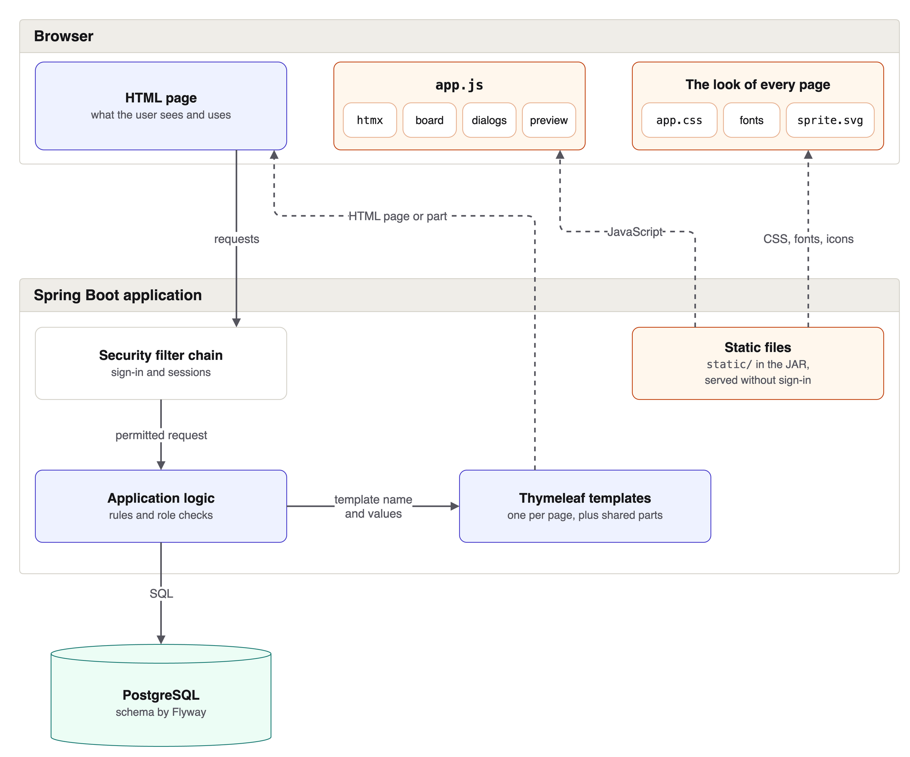
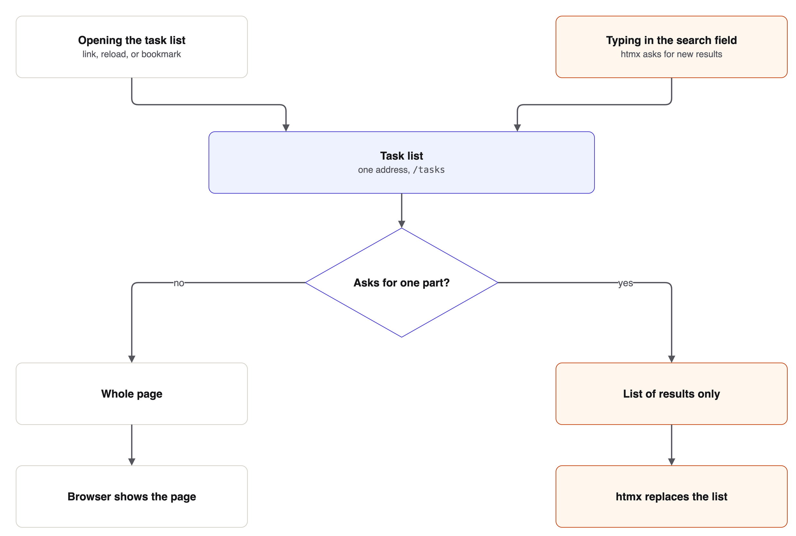

[.text-justify]
= Starter
:reproducible:
:doctype: article
:author: Herman Ciechanowiec
:email: herman@ciechanowiec.eu
:chapter-signifier:
:sectnums:
:sectnumlevels: 5
:sectanchors:
:toc: left
:toclevels: 5
:icons: font
:linkcss:
:sourcedir: {docdir}
:stylesdir: https://www.ciechanowiec.eu/linux_mantra/
:stylesheet: adoc-css-style.css
:!table-caption:
:!figure-caption:
:!example-caption:

ifdef::backend-html5[]
ifndef::env-github[]
++++
<link href="https://www.ciechanowiec.eu/linux_mantra/adoc-docinfo.css" rel="stylesheet">

++++
endif::[]
endif::[]

:l-spring-boot: https://spring.io/projects/spring-boot[Spring Boot^]
:l-spring-security: https://spring.io/projects/spring-security[Spring Security^]
:l-spring: https://spring.io/projects/spring-framework[Spring^]
:l-tailwind-css: https://tailwindcss.com/[Tailwind CSS^]
:l-docker: https://www.docker.com/[Docker^]
:l-maven: https://maven.apache.org/[Maven^]
:l-typescript: https://www.typescriptlang.org/[TypeScript^]
:l-java: https://dev.java/[Java^]
:l-thymeleaf: https://www.thymeleaf.org/[Thymeleaf^]
:l-htmx: https://htmx.org/[htmx^]
:l-javascript: https://tc39.es/ecma262/[JavaScript^]
:l-daisyui: https://daisyui.com/[daisyUI^]
:l-esbuild: https://esbuild.github.io/[esbuild^]
:l-nodejs: https://nodejs.org/[Node.js^]
:l-pnpm: https://pnpm.io/[pnpm^]
:l-npm: https://www.npmjs.com/[npm^]
:l-postgresql: https://www.postgresql.org/[PostgreSQL^]
:l-flyway: https://www.red-gate.com/products/flyway/[Flyway^]
:l-airness: https://github.com/ciechanowiec/airness[Airness^]
:l-chromium: https://www.chromium.org/[Chromium^]
:l-firefox: https://www.firefox.com/[Firefox^]
:l-webkit: https://webkit.org/[WebKit^]
:l-lucide: https://lucide.dev/[Lucide^]
:l-fontsource: https://fontsource.org/[Fontsource^]
:l-git: https://git-scm.com/[Git^]

[[abstract]]
== Abstract

This repository holds Starter, a multi-user task tracker that serves as a project template for new web applications. The {l-airness} build harness turns every rule that automation can verify into a check of the build, so changes that AI agents write can merge without a developer reading every line. The application renders HTML pages on the server, updates parts of the pages with {l-htmx}, and keeps its data in {l-postgresql}. One {l-maven} build turns the repository into a verified executable {l-java} archive (JAR). A project generated from the template keeps the accounts, the navigation, and the build, and replaces the task features, the demonstration data, the name, and the look.

[[template-and-purpose]]
== Purpose and Technologies

. Starter is a web application in which users sign in, keep tasks with a status and a due date, and see the tasks as a list or as a board with one column per status. An [[administrator]]_administrator_ is a user with the role `ADMIN`, who manages the accounts. The pages are available in English and in Polish.
. A _project template_ is a repository that new projects start from as copies. Starter is a project template. A [[generated-project]]_generated project_ is a copy of Starter under its own group, artifact, and package names. A generated project passes every check of the build from the start, so the first change of the generated project is made on a working base.
. The application combines, among others, the technologies in the following table.
+
[cols="2,3",options="header"]
|===
|Technology |Role in the application
|{l-java} 25 and {l-spring-boot} |respond to requests, check sign-in and roles, and run database transactions
|{l-thymeleaf} |renders HTML pages on the server
|{l-htmx} |replaces parts of a page without a full reload
|{l-tailwind-css} and {l-daisyui} |provide the utility classes, such as `p-4` for padding, and the ready-made interface elements of the style sheet
|{l-typescript} and {l-esbuild} |hold and bundle the xref:#page-script[page script]
|{l-nodejs} and {l-pnpm} |run the frontend build and the tests in browsers
|{l-postgresql} and {l-flyway} |store the data and create its schema
|{l-maven} and {l-airness} |build the application and verify every change
|{l-docker} |runs the database for tests and packages the application as an image
|===

[[airness-governance]]
== Airness Governance

{l-airness} is a _build harness_: {l-maven} parents, plugin goals, and {l-typescript} checks that a project inherits, so that changes that AI agents write can merge without a developer reading every line.

[[rules-and-checks]]
=== Rules and Checks

. {l-airness} turns every rule of the software project guideline, `README-guideline-software-project.adoc`, that automation can verify into a check of the build. Among others, the checks cover the tool versions and the dependencies, the formatting and the static analysis of the code, the tests and their coverage, the licenses and known vulnerabilities of the dependencies, the pages in real browsers, the {l-git} history, and the xref:#managed-file[managed files]. A change that breaks a checked rule fails the build in the same way as a failing test.
. `AGENTS.md` and the guides under `.airness/` state the rules that automation can't verify and the commands that AI agents run.
. A [[managed-file]]_managed file_ is a file, or a marked block inside a file, that {l-airness} writes into the repository and keeps identical to the copy that {l-airness} ships, such as the guides under `.airness/` and the blocks at the top of `AGENTS.md`. xref:#default-verification[Default verification] fails when a managed file differs from the {l-airness} copy, and the command `mvn airness:assets-sync` restores the managed file.

[[verification-levels]]
=== Verification Levels

{l-airness} checks a project at two verification levels. A change is ready to merge only when both levels pass.

. The command `mvn clean verify` runs [[default-verification]]_default verification_, which compiles and tests the code, runs the static analysis, and builds the executable JAR. Developers run default verification while they work.
. The [[browser-sweep]]_browser sweep_ is a check that opens every page reachable through the links of the application in {l-chromium}, {l-firefox}, and {l-webkit}, both without signing in and as an xref:#administrator[administrator], whom a setup step of the end-to-end tests signs in. The browser sweep checks each page for accessibility, display at different screen widths, and keyboard use.
. The command `mvn clean verify -Pextended` runs [[extended-verification]]_extended verification_, which adds the slower checks to xref:#default-verification[default verification]. Among others, extended verification scans for known vulnerabilities and secrets, checks the {l-git} history, and starts the container image. Extended verification also runs the [[browser-checks]]_browser checks_, the checks that run in real browsers against the executable JAR: the xref:#browser-sweep[browser sweep] and the end-to-end tests. At the end, extended verification writes a [[compliance-report]]_compliance report_, a document that lists the dependencies, their licenses, and their known vulnerabilities.

[[application-architecture]]
== Application Architecture

Starter is one {l-spring-boot} application without a separate frontend application: the browser receives finished HTML and the files that the pages load.

[[runtime-architecture]]
=== Runtime Architecture

. A [[static-file]]_static file_ is a file that {l-spring} sends to the browser unchanged, such as the style sheet or the favicon.
. The [[page-script]]_page script_ is the xref:#static-file[static file] `app.js`, the one {l-javascript} file that every page loads. The page script starts {l-htmx} and the parts of the pages that HTML alone can't do: dragging cards on the task board, confirming before a task is deleted, and the demonstration board. The source of the page script starts like this:
+
.`src/main/frontend/entries/app.ts`, shortened
[source,typescript]
----
import htmx from 'htmx.org'
import { enableBoard } from '@/board'
import { openNamedDialog } from '@/dialogs'
import { enablePreview } from '@/preview'

document.addEventListener('click', openNamedDialog)
enableBoard(document)
enablePreview(document)
----
. The _security filter chain_ is the series of {l-spring-security} filters that every request passes first. The security filter chain sends a user who hasn't signed in to the sign-in page, except on public addresses, such as the addresses of the xref:#static-file[static files].
. The [[application-logic]]_application logic_ is the {l-java} code that answers each permitted request. The application logic applies the business rules, including what each user may do, reads and writes the database, and fills a {l-thymeleaf} template with the result to render the HTML for the browser.
. The database schema changes only through {l-flyway} migrations, which the application applies at each start.
. The following figure shows the security filter chain, the xref:#application-logic[application logic], the xref:#templates[templates], and the xref:#static-file[static files] in a request:
+
[[runtime-architecture-figure]]
.Runtime architecture of Starter

[[templates]]
=== Templates

Pages are rendered from {l-thymeleaf} templates: HTML files under `templates/` that the xref:#application-logic[application logic] fills with values. A template can include another template, so a part that many pages share is written once. For example, this line of the navigation inserts the house icon from the template `components/icon.html`:

[source,html]
----
<svg th:replace="~{components/icon :: icon('house', 'size-4.5')}"></svg>
----

[[updating-pages]]
=== Updating Pages Without a Reload

. Every address of the application answers with a whole page, so each page also works on its own, for example after a reload or from a bookmark.
. When the user follows a link, {l-htmx} loads the next page in the background and replaces the current page without a full reload, so the screen doesn't flash.
. Some parts of a page update alone. For example, while the user types into the search field of the task list, htmx asks the same address, `/tasks`, for new results. htmx marks such a request, so the application renders only the list of results, and htmx replaces only that list. The following figure shows both cases:
+
[[page-rendering-figure]]
.One address for the whole page and for one part

[[languages-and-failures]]
=== Languages and Failures

. The texts of the interface are messages in `messages.properties` for English and in `messages_pl.properties` for Polish. The application answers a request in the language from the cookie of the language switch, otherwise in the language that the browser asks for when the application supports it, and otherwise in English.
. The application answers every failed request with one failure page. For a fault in the code, the failure page shows only an identifier under which the application logged the details.

[[security-and-accounts]]
=== Security and Accounts

{l-spring-security} protects the application.

. *Accounts and roles*
+
A user signs in with an email address and a password. The [[first-administrator]]_first administrator_ is the xref:#administrator[administrator] account that the application creates from two environment variables at the first start against an empty database, so no password is built into the JAR. An administrator adds every other account with the role `USER` or `ADMIN`. A user with the role `USER` keeps their own tasks, and an administrator also sees every task.
. *Role checks*
+
Before every action, the xref:#application-logic[application logic] checks that the role of the user allows the action. For example, only a user with the role `ADMIN` can add an account.
. *Audit trail*
+
The application writes to an audit trail every attempt to sign in or to prove a password, every change to an account, and every change an administrator makes to somebody else's task. The database itself refuses to change or delete the entries of the audit trail.
. *Demonstration data*
+
[[demonstration-data-definition]]_Demonstration data_ is a set of demonstration accounts and their tasks that the application writes at the start when the environment variable `APP_DEMO_DATA` is `true` and the database holds no demonstration account yet. The environment file `.env.example` turns the demonstration data on. A deployment that doesn't set `APP_DEMO_DATA` starts with only the xref:#first-administrator[first administrator].

[[repository-architecture]]
== Repository Architecture

The repository root holds both the {l-maven} module and the [[node-project]]_Node project_, the part of the repository that `package.json` describes. {l-maven} drives the whole build. The Node project builds the style sheet and the xref:#page-script[page script] and runs the xref:#browser-checks[browser checks].

[[directory-structure]]
=== Directory Structure

The following tree shows the main directories and files of the repository. The numbers in the tree point to the explanations after the tree.

[source,text]
----
starter/
├── pom.xml                                <1>
├── package.json                           <2>
├── pnpm-lock.yaml                         <2>
├── src/
│   ├── main/
│   │   ├── java/                          <3>
│   │   ├── frontend/                      <4>
│   │   └── resources/
│   │       ├── templates/                 <5>
│   │       ├── db/migration/              <6>
│   │       ├── static/                    <7>
│   │       ├── messages.properties        <8>
│   │       ├── messages_pl.properties     <8>
│   │       └── application.yaml           <9>
│   └── test/
│       └── java/                          <10>
├── scripts/                               <11>
├── tests/                                 <12>
├── Dockerfile                             <13>
├── compose.yaml                           <13>
├── .env.example                           <13>
├── .github/workflows/                     <14>
├── .airness/                              <15>
├── AGENTS.md                              <16>
├── README.adoc                            <17>
├── README-guideline-software-project.adoc <17>
├── README-guideline-writing.adoc          <17>
└── .adocent/                              <18>
----
<1> The {l-maven} module.
<2> The xref:#node-project[Node project] and its lock file.
<3> The {l-java} code.
<4> The sources of the style sheet and the xref:#page-script[page script].
<5> The xref:#templates[templates].
<6> The {l-flyway} migrations.
<7> The xref:#static-file[static files] kept in the repository.
<8> The message files in English and Polish.
<9> The runtime settings.
<10> The {l-java} tests.
<11> The scripts of the frontend build and of the test database.
<12> The tests of the xref:#page-script[page script] and the frontend build, and the end-to-end tests.
<13> The container image and the local start.
<14> The workflow that runs xref:#extended-verification[extended verification] every week and on demand.
<15> The files of {l-airness}.
<16> The instructions for AI agents.
<17> This README, its writing guideline, and the software project guideline whose automatable rules {l-airness} checks.
<18> The configuration of the documentation linter and the diagrams of this README.

[[maven-build]]
=== Maven Build and Container Image

. One {l-maven} build runs both xref:#verification-levels[verification levels]: `mvn clean verify` runs xref:#default-verification[default verification], and `mvn clean verify -Pextended` also runs xref:#extended-verification[extended verification].
. xref:#default-verification[Default verification] checks the tool versions, installs the {l-npm} packages, and runs the xref:#frontend-build[frontend build]. Default verification then compiles, checks, and tests the {l-java} code and packages the executable JAR, which holds every dependency and starts with `java -jar`.
. xref:#extended-verification[Extended verification] adds three steps to the build: the scans for vulnerabilities and secrets after packaging, the xref:#browser-checks[browser checks] against the executable JAR, and the xref:#compliance-report[compliance report] at the end.
. The build doesn't use a {l-nodejs} installed on the machine. On the first run, {l-airness} downloads the official {l-nodejs} and {l-pnpm} programs of the versions that {l-airness} pins, checks their checksums, and keeps the programs in the local {l-maven} repository. Every later run of the xref:#node-project[Node project] uses those copies, so every machine builds with the same versions.
. The `Dockerfile` builds the container image from the executable JAR, and the file `compose.yaml` starts the image beside a {l-postgresql} container with the settings from `.env`.

[[frontend-build]]
=== Frontend Build

. The [[frontend-resources-definition]]_frontend resources_ are the files that the frontend build generates: the xref:#page-script[page script] `app.js`, the style sheet `app.css`, the font files, the icon sprite `sprite.svg`, and the license files of the shipped packages. The {l-pnpm} script `build` writes the frontend resources into `target/frontend`, which {l-git} ignores, and {l-maven} packages `target/frontend` into the JAR as `static`, apart from the license files. The following figure shows the inputs, the tools, and the outputs of the frontend build:
+
[[frontend-build-figure]]
.Frontend build from sources to the executable JAR
image::.adocent/resources/visuals/frontend-build.drawio.png["Five rows lead from the inputs to target/frontend. The sources of the page script and the htmx package pass through the esbuild bundle into js/app.js. The source of the style sheet, the class names in the templates, Tailwind CSS, and daisyUI pass through the Tailwind command-line tool into css/app.css. The Fontsource packages pass through the font copy into css/files. The icon names in the templates and the Lucide package pass through the sprite assembly into icons/sprite.svg. The license files pass through the license copy into licenses. Maven packages target/frontend into the executable JAR. Spring serves the files under static, but not the license files, which go under META-INF/licenses."]
. *Page script*
+
The xref:#page-script[page script] goes from its source to the browser in four steps.
+
.. The source is a few {l-typescript} files under `src/main/frontend/`. {l-typescript} is {l-javascript} with type annotations, such as `Document` and `void` here:
+
[source,typescript]
----
export const enableBoard = (root: Document): void => { ... }
----
.. {l-esbuild}, a build tool for {l-javascript}, reads `app.ts`. Each `import` line in `app.ts` names another piece of code that the page script needs, such as the file `board.ts` or the package {l-htmx}, and {l-esbuild} reads that code too:
+
[source,typescript]
----
import htmx from 'htmx.org'
import { enableBoard } from '@/board'
----
.. {l-esbuild} removes the type annotations, because a browser runs only {l-javascript}:
+
[source,javascript]
----
const enableBoard = (root) => { ... }
----
.. {l-esbuild} joins all the code into the one file `app.js`, which `layout/page.html` loads on every page:
+
[source,html]
----

----
. *Style sheet*
+
{l-tailwind-css} builds the style sheet `app.css` in two steps.
+
.. A template styles an element with class names instead of separate CSS rules. {l-tailwind-css} supplies class names that each set one property, such as `p-4` for padding. {l-daisyui}, a plugin of {l-tailwind-css}, adds class names for whole controls, such as `btn` for a button:
+
[source,html]
----
<button class="btn p-4">Save</button>
----
.. {l-tailwind-css} reads every template as plain text, finds the class names `btn` and `p-4`, and writes the CSS for both class names into `app.css`:
+
[source,css]
----
.btn { /* the look of a button */ }
.p-4 { padding: 1rem; }
----
. *Fonts*
+
The font files come from {l-fontsource} packages and ship with the application, so the pages load no font from another server.
. *Icons*
+
The icons come from {l-lucide}, a set of more than a thousand icons. The build copies only the icons that the templates name into the one file `sprite.svg`, so a page downloads one small file instead of the whole set.
. *Licenses*
+
The build copies the license file of each package whose code the frontend resources carry into `licenses/`, and {l-maven} packages these license files into the JAR under `META-INF/licenses`, which the application doesn't serve.

== About the Document

. The source text of this document is written in the https://asciidoc.org[AsciiDoc^] markup language.
. The source text of this document must follow the link:README-guideline-writing.adoc[Writing Guideline for Utilitarian Non-Fiction^]. The guideline is stored beside the source text in the same Git repository.
. The https://github.com/ciechanowiec/adocent[`adocent`^] application lints, converts, and watches the source text of this document.
. *Usage of https://github.com/ciechanowiec/adocent[`adocent`^]*
+
`adocent usage` prints the complete https://github.com/ciechanowiec/adocent[`adocent`^] manual and JSON reference catalogs, producing a large output. Don't run it during routine writing. Use it only when command help and lint diagnostics don't resolve a specific usage problem. Save the output to a temporary file and read only the relevant sections. AI agents must not load the full output into their context.
. *Linting*
+
To lint the source text of this document, run this command from the directory containing the source text:
+
[source,bash,subs="attributes+"]
----
adocent lint "{docname}{docfilesuffix}"
----
. *Converting*
+
To convert this document to HTML, PDF, and DOCX, run this command from the directory containing the source text:
+
[source,bash,subs="attributes+"]
----
adocent convert "{docname}{docfilesuffix}" --to html --to pdf --to docx
----
. *Watching*
+
To open a live HTML preview of this document, run this command from the directory containing the source text:
+
[source,bash,subs="attributes+"]
----
adocent watch "{docname}{docfilesuffix}"
----

ifdef::backend-html5[]
ifndef::env-github[]
++++

++++
endif::[]
endif::[]
